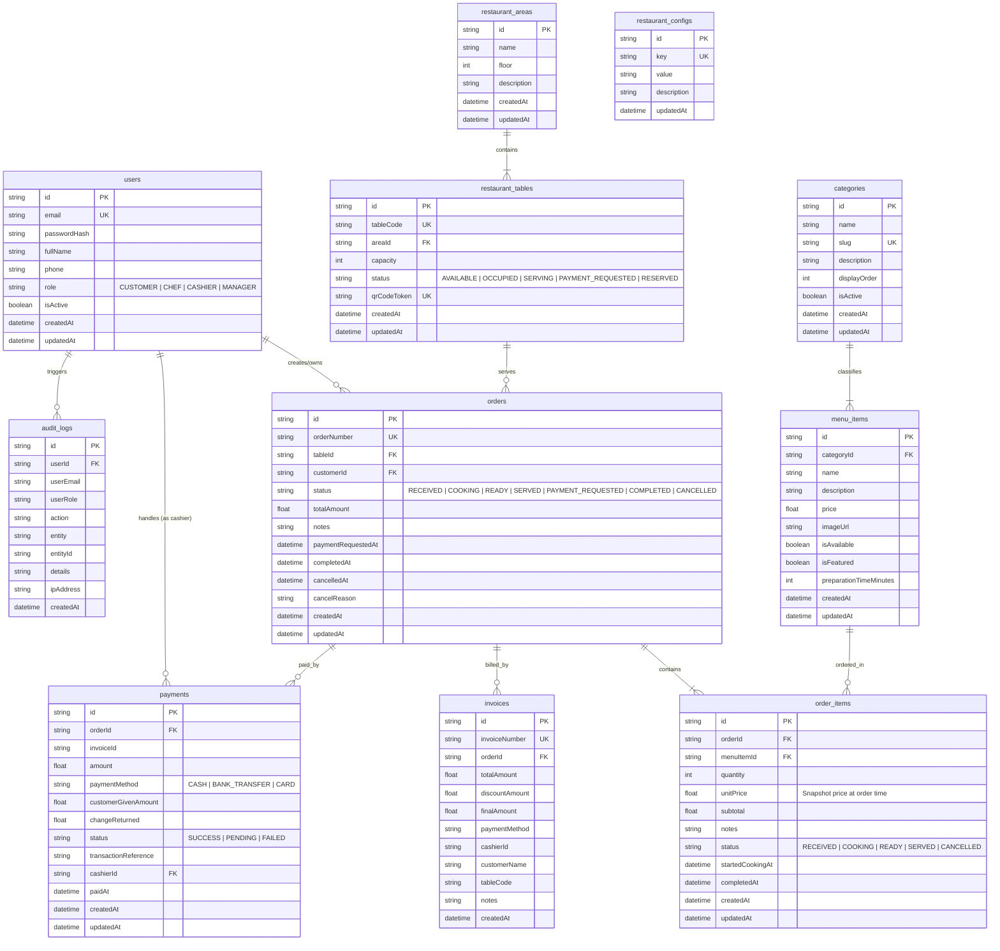

# SƠ ĐỒ THỰC THỂ QUAN HỆ (ERD) - SELF RESTAURANT

Hệ thống cơ sở dữ liệu của **SELF RESTAURANT** được thiết kế chuẩn hóa, quan hệ chặt chẽ giữa khách hàng, bàn ăn, thực đơn, đơn hàng, hóa đơn thanh toán và nhật ký kiểm toán.

## 1. Sơ Đồ Mermaid ERD

## 2. Các Quy Tắc Toàn Vẹn Dữ Liệu Quan Trọng

1. **Bảo tồn giá bán (Price Snapshot):**
   - Trường `order_items.unitPrice` lưu lại chính xác đơn giá của món ăn tại thời điểm khách gọi món.
   - Nếu Quản lý thay đổi giá của món trong `menu_items`, giá lịch sử của các đơn hàng và hóa đơn đã lập trước đó hoàn toàn không bị thay đổi.

2. **Chống lỗi "Bàn có món nhưng thu ngân báo chưa có món":**
   - Quan hệ giữa `restaurant_tables` và `orders` được truy vấn chặt chẽ thông qua API `GET /api/orders/table/:tableId/active`.
   - Backend chỉ lấy các đơn có trạng thái chưa kết thúc (`status NOT IN ('COMPLETED', 'CANCELLED')`) và luôn thực hiện `include: { items: { include: { menuItem: true } } }`.

3. **Tự động giải phóng bàn khi thanh toán:**
   - Khi Thu ngân xác nhận thanh toán (`POST /api/payments/checkout`), hệ thống kiểm tra và tự động cập nhật `restaurant_tables.status = 'AVAILABLE'` trong cùng 1 Prisma Transaction.

4. **Bảo vệ toàn vẹn lịch sử (Soft-deactivate):**
   - Khi Quản lý xóa món ăn đã từng xuất hiện trong `order_items`, hệ thống tự động chuyển món sang `isAvailable = false` thay vì xóa cứng làm hỏng dữ liệu báo cáo doanh thu.
